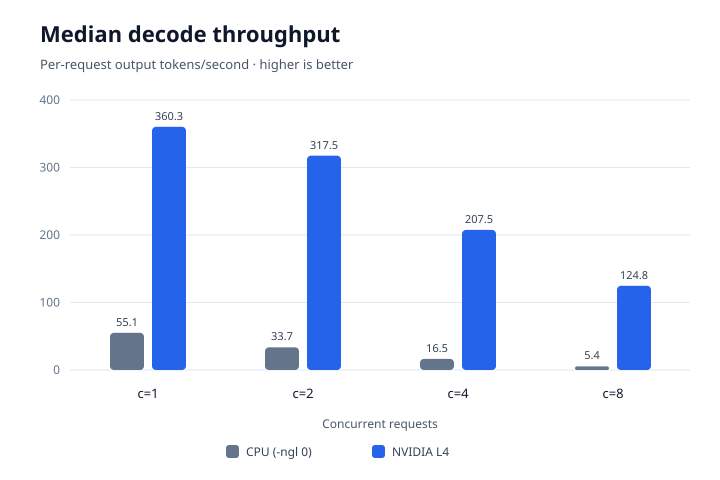

<div align="center">

# Liffo

**A reliability and observability layer for local LLM inference.**

Route, protect, observe, and benchmark OpenAI-compatible `llama.cpp` workers
without replacing the inference engine.


[Quick start](#quick-start) · [Architecture](#architecture) · [Capabilities](#capabilities) · [Documentation](#documentation)

</div>

Liffo sits between an OpenAI-compatible client and one or more local inference
workers. It supplies the control-plane behavior that a standalone model server
does not: bounded admission, load-aware routing, safe streaming recovery,
process lifecycle coordination, metrics, traces, and reproducible benchmark
output.

Liffo complements `llama.cpp`; it does not replace its model runtime,
continuous batching, scheduler, or GPU kernels.

## Why Liffo?

| Concern | Direct model-server endpoint | With Liffo |
|---|---|---|
| Multiple workers | Client manages endpoints | One gateway with selectable routing policies |
| Overload | Work accumulates at the server or client | Bounded admission and explicit queue shedding |
| Streaming failures | Recovery is application-specific | Retry only while no output is visible |
| Model replacement | External process scripts | Load → ready → drain → evict lifecycle |
| Unequal workers | Capacity is usually client-blind | Capacity- and estimated-work-aware routing |
| Operations | Server-specific logs | Health, readiness, Prometheus metrics, and OTel spans |
| Benchmarking | Ad hoc scripts | Privacy-safe JSONL plus TTFT, latency, and throughput reports |

## Liffo compared with inference engines

Liffo, `llama.cpp`, and DeepInfer solve different layers of the inference
stack. Liffo is not another model runtime: it coordinates workers that already
expose an OpenAI-compatible API.

| Dimension | Liffo | [llama.cpp](https://github.com/ggml-org/llama.cpp) | [DeepInfer](https://github.com/deepseek-ai/DeepInfer) |
|---|---|---|---|
| Primary role | Reliability, routing, lifecycle, observability, and benchmarking control plane | GGUF model runtime and local inference server | High-performance inference framework for DeepSeek models |
| Runs model kernels | No—delegates generation to workers | Yes | Yes |
| Current serving surface | OpenAI-compatible multi-worker gateway | OpenAI-compatible worker/server | Public release demonstrates offline inference; a complete service requires additional components |
| Scheduling focus | Cross-worker admission, placement, capacity, and safe recovery | In-engine request and token execution | Asynchronous batch scheduling, parallelism, and optimized device execution |
| Hardware relationship | Inherits worker support; records actual CPU/GPU conditions | Provides the reference local CPU/GPU backend for Liffo | Current README lists NVIDIA SM100 and Huawei Ascend 950 |
| Multi-worker load balancing | Included | Outside Liffo-style control-plane scope | Listed as required but not included in the current public release |
| Best fit | Operating and measuring local or private OpenAI-compatible worker fleets | Running broad GGUF models locally | Running supported DeepSeek models on its targeted accelerator platforms |

The projects are complementary at different boundaries. Liffo currently uses
`llama-server` as its reference worker. It does not claim direct DeepInfer
integration because DeepInfer's current public release does not expose the
worker API Liffo expects.

## Capabilities

| Area | Included in this release candidate |
|---|---|
| Gateway | Streaming and non-streaming `/v1/chat/completions` |
| Admission | Bounded in-flight work, bounded waiters, timeout, and fast shedding |
| Routing | Round-robin, least-inflight, prefix affinity, hybrid, capacity-normalized, estimated-workload, and multi-SLO |
| Recovery | Worker health cooldown and retry before visible streamed output |
| Lifecycle | Local llama.cpp process loader, authenticated mutation, and drain-before-evict state machine |
| Observability | Prometheus metrics, OpenTelemetry spans, health/readiness, and worker status |
| Benchmarking | TTFT, latency, output rate, RAM/VRAM/GPU samples, and Markdown/JSON reports |
| Privacy | Prompt IDs and SHA-256 hashes by default; no prompt or completion bodies in raw results |

The multi-worker lifecycle coordinator and authenticated remote-agent loader are
tested in the core. The CLI currently exposes external workers and the simpler
single-local-worker managed lifecycle.

## Architecture

```text
OpenAI-compatible client
          │
          ▼
┌──────────────────────────────────────────────┐
│                    Liffo                     │
│ security → admission → lifecycle → routing   │
│                 │                            │
│       metrics + traces + audit state         │
└─────────────────┬────────────────────────────┘
                  │ select + reserve
          ┌───────┼────────┐
          ▼       ▼        ▼
       worker 0  worker 1  worker N
       llama.cpp llama.cpp OpenAI-compatible
```

The request path preserves three important invariants:

1. Admission happens before worker reservation, so rejected work cannot consume
   worker capacity.
2. Worker selection and reservation are atomic, so concurrent requests observe
   current load.
3. A streamed request is retried only before user-visible output, preventing
   duplicated or spliced completions.

Liffo admission schedules requests at the gateway. It is not a replacement for
llama.cpp continuous batching.

## Quick start

### Prerequisites

- Go 1.27.3
- A recent `llama-server`
- A GGUF model
- Optional: `nvidia-smi` for NVIDIA GPU resource samples

The pinned Go patch version avoids reachable standard-library advisories found
in earlier 1.27 releases.

### Build and verify

```sh
git clone https://github.com/Priyanshuthapliyal2005/Liffo.git
cd Liffo
make check
```

Without Make:

```sh
go test ./...
go vet ./...
go test -race ./...
go build -trimpath -o bin/liffo ./cmd/liffo
```

PowerShell uses the same Go commands; choose `bin/liffo.exe` as the output
path.

### Start a real inference worker

CPU example:

```sh
llama-server \
  -m /absolute/path/model.gguf \
  --host 127.0.0.1 \
  --port 8080 \
  -c 2048 \
  -ngl 0
```

The supplied gateway configuration expects that worker at
`http://127.0.0.1:8080`.

### Start Liffo

```sh
./bin/liffo gateway --config configs/gateway.yaml
```

Expected startup summary:

```text
liffo gateway listen=127.0.0.1:8088 workers=1 mode=static route=least_inflight lifecycle=false
```

### Verify and benchmark

In another terminal:

```sh
./bin/liffo status --gateway http://127.0.0.1:8088

./bin/liffo bench \
  --config configs/bench.yaml \
  --mode cpu \
  --total-requests 10

./bin/liffo report \
  --raw results/raw \
  --target "describe the actual CPU, RAM, GPU, and OS"
```

Raw request rows are written under `results/raw/`; generated Markdown and JSON
reports are written under `reports/`. Both directories ignore generated output
by default.

## Reference benchmark

CPU and GPU matrices ran sequentially on the same Linux x86_64 allocation with
an AMD EPYC 7R13, NVIDIA L4, llama.cpp b12177, and Qwen2.5-0.5B-Instruct
Q4_K_M. Each concurrency cell contains 32 measured requests; all 256 requests
completed successfully with zero SSE parse errors.

| Median per-request decode throughput ↑ | Median time to first token ↓ |
|---|---|
|  |  |

The GPU run records full `25/25` layer offload. These are reference results for
one small model and one hardware allocation—not universal performance claims.
See the [hardware manifest, complete values, metric definitions, and
reproduction guidance](docs/BENCHMARKS.md).

## GPU inference

Use an `-ngl` value appropriate for the model and available VRAM, then label
the benchmark `--mode gpu`. A valid GPU result must retain a real
`llama-server` log line showing how many layers were offloaded. GPU utilization
alone is not proof of model offload.

Do not present measurements from different CPUs, GPUs, operating systems,
llama.cpp revisions, model hashes, quantizations, or concurrency settings as a
matched before/after comparison.

## Managed model lifecycle

Liffo can start and stop a local `llama-server` from allowlisted model IDs.
Copy the example and replace every placeholder path:

```sh
cp configs/gateway-managed.example.yaml configs/gateway-managed.yaml
export LIFFO_ADMIN_TOKEN='generate-a-long-random-token'
./bin/liffo gateway --config configs/gateway-managed.yaml
```

Managed model files must resolve beneath `model_root`, including after symlink
resolution. Request-provided filesystem paths are never accepted.

```text
stopped → loading → ready → draining → evicting → stopped
                     └──────── failure ────────→ failed
```

During replacement or shutdown, Liffo stops new lifecycle admissions, waits
for active leases to drain, and then terminates the managed process.

## Routing policies

| Policy | Intended use |
|---|---|
| `round_robin` | Simple even request distribution |
| `least_inflight` | Prefer the worker with the least active work |
| `prefix_sticky` | Preserve prompt-prefix affinity when healthy and available |
| `hybrid` | Balance affinity, load, cache age, and health |
| `capacity_normalized_least_inflight` | Account for heterogeneous worker capacity |
| `shortest_estimated_workload` | Prefer the shortest estimated service queue |
| `multi_slo` | Score cost, latency, load, quality, and SLO headroom |

Routing metadata never stores raw prompt text. Affinity keys use SHA-256 hashes.

## Observability

| Endpoint | Purpose |
|---|---|
| `GET /health` | Process liveness |
| `GET /ready` | Gateway and worker readiness |
| `GET /v1/workers` | Registered worker health and load |
| `GET /v1/models` | Active model and lifecycle view |
| `GET /metrics` | Prometheus exposition |
| `GET /v1/obs/samples` | Bounded in-memory telemetry samples |

Lifecycle mutation and event endpoints require the bearer token from
`LIFFO_ADMIN_TOKEN`. Ordinary completion requests are not authenticated; keep
the supplied loopback binding or place Liffo behind an authenticating TLS
reverse proxy.

## Supported environments

| Target | Candidate evidence |
|---|---|
| macOS arm64 | Build, vet, race suite, and streaming smoke test passed |
| Linux amd64 | Cross-build passed; CI workflow included |
| Windows amd64 | Cross-build passed; native process control and CI workflow included |
| Backend API | OpenAI-compatible `/v1/chat/completions`; llama.cpp is the reference backend |

This table describes software validation, not equivalent performance across
hardware.

## Validation

The release gate covers unit and HTTP integration tests, `go vet`, the Go race
detector, native arm64 compilation, Linux and Windows amd64 cross-builds,
dependency-license classification, vulnerability scanning, and secret
scanning. The current candidate passes every local gate; see the exact
environment and limitations in [docs/VALIDATION.md](docs/VALIDATION.md).

## Project status and scope

Liffo is currently a release candidate. It intentionally does not include:

- GGUF models or llama.cpp binaries
- model downloads or hosted inference
- TLS or authentication for ordinary completion requests
- a web UI
- private benchmark traces or research datasets
- performance claims without reproducible hardware evidence

Before a stable release, the project still needs real CPU/GPU validation on the
intended Windows hardware, hosted CI execution, and release SBOM/provenance
generation.

## Repository layout

```text
cmd/liffo/          CLI: gateway, status, bench, and report
internal/adapt/     admission, gateway, streaming, and adaptive control
internal/route/     routing, reservation, and safe retry
internal/modellife/ model/process lifecycle and coordination
internal/obs/       Prometheus and OpenTelemetry
internal/client/    real streaming benchmark client
configs/            runnable and managed-lifecycle examples
docs/               architecture, validation, and release audit
```

## Documentation

- [Architecture and request invariants](docs/ARCHITECTURE.md)
- [Reference benchmark and reproduction details](docs/BENCHMARKS.md)
- [Real CPU/GPU inference guide](docs/REAL_INFERENCE.md)
- [Release-candidate validation](docs/VALIDATION.md)
- [Retained, removed, and deferred audit](docs/RELEASE_AUDIT.md)
- [Private/public change workflow](docs/PORTING.md)
- [Security policy](SECURITY.md)
- [Third-party dependency inventory](THIRD_PARTY_NOTICES.md)
- [Contributing](CONTRIBUTING.md)

## Acknowledgments

Liffo uses the OpenAI-compatible server interface provided by `llama.cpp` and
builds its operational telemetry on Prometheus and OpenTelemetry. Those
projects make a small, inspectable local inference control plane possible.

## License

Liffo is available under the Apache License 2.0. See [LICENSE](LICENSE).
