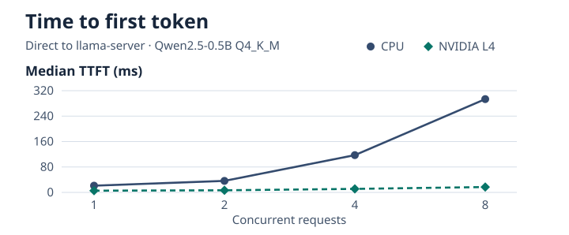

<div align="center">


# Liffo

**Reliability, routing, observability, and benchmarks for local LLM inference.**


[Getting started](#getting-started) · [Benchmarks](#reference-benchmarks) · [Documentation](#documentation) · [Contributing](CONTRIBUTING.md)

</div>

Liffo is a local-first control plane for OpenAI-compatible inference workers.
It adds bounded admission, load-aware routing, safe streaming recovery, model
lifecycle coordination, telemetry, and reproducible benchmarking without
replacing the model runtime.

## Supported backends and models

- OpenAI-compatible `/v1/chat/completions` workers
- `llama-server` is the validated reference backend
- Model-agnostic routing; GGUF models are managed through allowlisted logical IDs
- Validated with Qwen2.5-0.5B-Instruct Q4_K_M on CPU and NVIDIA L4

## Supported features

- Streaming and non-streaming chat-completion gateway
- Bounded in-flight admission, bounded waiters, timeout, and overload shedding
- Round-robin, least-inflight, prefix-affinity, hybrid, capacity-aware,
  estimated-workload, and multi-SLO routing
- Atomic worker selection and capacity reservation
- Retry only before user-visible streamed output
- Load → ready → drain → evict process lifecycle
- Prometheus metrics, OpenTelemetry spans, health, readiness, and worker status
- TTFT, latency, throughput, RAM, VRAM, and GPU-utilization benchmarking
- Privacy-safe results: prompt IDs and hashes, not prompt or completion bodies

## Where Liffo fits

Liffo operates above inference engines; it does not execute model kernels.

| | Liffo | [llama.cpp](https://github.com/ggml-org/llama.cpp) | [DeepInfer](https://github.com/deepseek-ai/DeepInfer) |
|---|---|---|---|
| Primary role | Multi-worker control plane | GGUF model runtime and server | High-performance DeepSeek inference framework |
| Scheduling boundary | Cross-worker admission, placement, and recovery | In-engine request and token execution | Device execution, parallelism, and asynchronous batch scheduling |
| Serving status | OpenAI-compatible gateway | OpenAI-compatible reference worker | Current public release demonstrates offline inference; complete serving needs additional components |
| Best fit | Operating and measuring private worker fleets | Running broad GGUF models locally | Supported DeepSeek models on targeted accelerators |

Liffo currently integrates with `llama-server`. It does not claim direct
DeepInfer integration because DeepInfer's current public release does not
expose the worker API Liffo expects.

## Supported environments

- macOS arm64: build, vet, race suite, and streaming integration test passed
- Linux amd64: cross-build passed; CI workflow included
- Windows amd64: cross-build passed; native managed-process support included
- Optional NVIDIA sampling through `nvidia-smi`

Required for a complete deployment but not included in this release:

- An inference worker and model weights
- TLS and ordinary-request authentication for non-loopback exposure
- Model downloads or hosted inference
- A web interface
- A claim that measurements from different hardware are directly comparable

## Getting started

### Prerequisites

- Go 1.27.3
- A recent `llama-server`
- A GGUF model

### Build

```sh
git clone https://github.com/Priyanshuthapliyal2005/Liffo.git
cd Liffo
make check
```

Or build the CLI directly:

```sh
go build -trimpath -o bin/liffo ./cmd/liffo
```

### Run

Start a CPU worker:

```sh
llama-server -m /path/model.gguf --host 127.0.0.1 --port 8080 -c 2048 -ngl 0
```

Start Liffo and verify the mesh:

```sh
./bin/liffo gateway --config configs/gateway.yaml
./bin/liffo status --gateway http://127.0.0.1:8088
```

Run a privacy-safe benchmark and generate a report:

```sh
./bin/liffo bench --config configs/bench.yaml --mode cpu --total-requests 10
./bin/liffo report --raw results/raw --target "actual CPU, RAM, GPU, and OS"
```

For managed llama.cpp lifecycle, copy
`configs/gateway-managed.example.yaml`, replace its paths, and set a long random
`LIFFO_ADMIN_TOKEN`.

## Reference benchmarks

CPU and GPU matrices ran sequentially on the same Linux x86_64 allocation with
an AMD EPYC 7R13, NVIDIA L4, llama.cpp b12177, and Qwen2.5-0.5B-Instruct
Q4_K_M. Each concurrency cell contains 32 measured requests; all 256 requests
completed successfully with zero SSE parse errors.

| Median per-request decode throughput ↑ | Median time to first token ↓ |
|---|---|
|  |  |

The GPU run records full `25/25` layer offload. These results describe one
small model and one hardware allocation, not universal performance. See the
[complete values, metric definitions, and reproduction guidance](docs/BENCHMARKS.md).

## Validation

The release gate includes build, unit and HTTP integration tests, `go vet`, the
race detector, Linux/Windows cross-builds, dependency verification,
`govulncheck`, license classification, and secret scanning. The current
candidate passes every local gate.

See [validation evidence](docs/VALIDATION.md) and the [release audit](docs/RELEASE_AUDIT.md).

## Documentation

- [Architecture and request invariants](docs/ARCHITECTURE.md)
- [Reference benchmark methodology](docs/BENCHMARKS.md)
- [Real CPU/GPU inference guide](docs/REAL_INFERENCE.md)
- [Runnable configurations](examples/README.md)
- [Private/public change workflow](docs/PORTING.md)
- [Security policy](SECURITY.md)
- [Third-party dependency inventory](THIRD_PARTY_NOTICES.md)
- [Contributing](CONTRIBUTING.md)

## License

Liffo is released under the Apache License 2.0. See [LICENSE](LICENSE).

## Acknowledgments

Liffo builds on the OpenAI-compatible server interface provided by
`llama.cpp`, with operational telemetry from Prometheus and OpenTelemetry.
