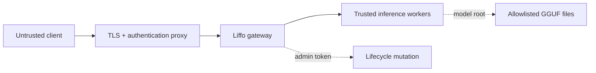

# Security policy

> Liffo is designed for loopback or trusted private networks. Non-loopback
> exposure requires a separate TLS and authentication boundary.

[Project overview](README.md) · [Architecture](docs/ARCHITECTURE.md) · [Validation](docs/VALIDATION.md)

---

## Supported trust boundary

Liffo does not authenticate ordinary completion requests and does not
terminate TLS. Place an authenticated reverse proxy in front of the gateway
before exposing it beyond loopback or a trusted network.

## Built-in controls

| Control | Protection |
|---|---|
| Bounded admission | Limits active requests and queued waiters under overload |
| Admin token | Protects lifecycle mutation endpoints through `LIFFO_ADMIN_TOKEN` |
| Logical model allowlist | Prevents arbitrary model-path selection by API clients |
| Root confinement | Resolves model paths beneath `model_root`, including symlinks |
| Pre-output-only retry | Avoids duplicating visible streamed output |
| Privacy-safe results | Omits prompt and completion bodies from generated JSONL |

## Deployment checklist

- [ ] Bind to loopback unless a trusted network boundary is intentional
- [ ] Put TLS, client authentication, and external rate limiting at the edge
- [ ] Generate a long random `LIFFO_ADMIN_TOKEN` and inject it at runtime
- [ ] Restrict worker ports so clients cannot bypass the gateway
- [ ] Use a read-only, least-privilege model directory
- [ ] Review logs and telemetry destinations for sensitive application metadata
- [ ] Scan dependencies and the final binary artifact before release
- [ ] Verify managed processes terminate during shutdown and failure recovery

## Reporting a vulnerability

Do not publish exploit details, prompts, model data, credentials, or private
deployment information in a GitHub issue. Report the problem privately to the
repository owner once a public security-contact channel is listed.

Until that channel exists, the absence of a private reporting address remains
a release blocker for a formally supported distribution.

## Secrets and sensitive artifacts

Never commit `.env` files, bearer tokens, private keys, GGUF models, raw
request traces, or local configuration containing absolute paths. If a secret
is committed, revoke it first; deleting the file in a later commit is not
sufficient.
