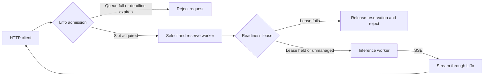

# Architecture

Liffo controls how requests reach workers. The workers load models, batch
tokens, and generate output.

## HTTP request path

A request waiting for admission holds no worker reservation. Policy-based
selection and reservation are atomic so concurrent routing decisions account
for work already assigned. The reservation is a gateway load signal. The
worker manages its own inference slots.

A readiness lease protects a managed model from eviction while a request
is running. Liffo rolls back the worker reservation if it cannot acquire the
lease. During a drain, existing requests can finish and new leases are refused.
The managed CLI starts one local `llama-server` for an allowlisted model ID
and waits for it to become healthy. The model file must resolve under
`model_root`. See the [managed-worker setup](REAL_INFERENCE.md#managed-worker).

## Stream failures

The HTTP gateway makes one completion attempt. Client cancellation propagates
upstream, and an incomplete upstream stream can mark the worker unhealthy for
later requests. The internal Go executor used by `Gateway.Handle` can retry
eligible failures before the first user-visible content when `retry_enabled`
is set. In that path, a configured lease is acquired before the executor
reserves a worker.

## Routing

| Policy | Selection signal |
| --- | --- |
| Round robin | Rotate through available workers |
| Least in-flight | Current in-flight count, with rotation for idle ties |
| Prefix affinity | Worker affinity for shared prefixes |
| Hybrid | Load, affinity, and health |
| Capacity-normalized least in-flight | In-flight count divided by configured capacity |
| Shortest estimated workload | In-flight count times estimated service time, divided by capacity |
| Multi-SLO | Configured cost and quality plus observed or estimated latency and load |

The workload estimate uses a latency prior or a moving average of time to
first token. The two capacity-normalized policies break ties by worker ID.
Prefix affinity is a routing hint. Cache reuse depends on the worker.

## Limits

The admission bound covers active requests and queue waiters. Bound accepted
connections and HTTP handlers separately at the edge. See the
[deployment policy](../SECURITY.md) and [validation](VALIDATION.md).
