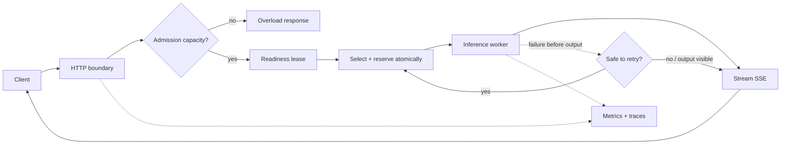
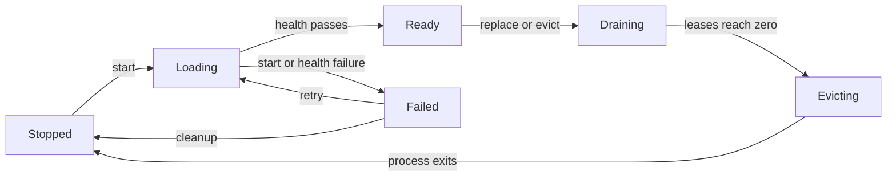

# Architecture

> Liffo is the reliability layer between an OpenAI-compatible client and one
> or more inference workers.

[Documentation](README.md) · [Run it](REAL_INFERENCE.md) · [Benchmarks](BENCHMARKS.md)

---

## The design in one picture

The important ordering is **admit → lease → select and reserve → stream**.
Changing that sequence can leak capacity, route to draining models, or let an
unbounded number of requests wait inside the gateway.

## Request path

| Stage | Responsibility | Failure behavior |
|---|---|---|
| HTTP boundary | Parse the OpenAI-compatible request and establish cancellation | Invalid requests fail before consuming worker capacity |
| Bounded admission | Limit active requests and queued waiters | Excess load is rejected predictably instead of accumulating |
| Lifecycle lease | Prevent a selected model from being evicted mid-request | Only ready models receive new work |
| Route + reserve | Choose a worker and claim capacity as one operation | Concurrent requests cannot select the same final slot |
| Upstream stream | Forward SSE without buffering the whole completion | Cancellation propagates to the worker |
| Recovery | Retry only before user-visible output | A response is never silently duplicated after streaming begins |
| Observation | Record metrics and spans | Prompt and completion bodies are not persisted |

Both direct and HTTP requests enter the same admission and lifecycle sequence.
That shared path prevents internal callers from bypassing the safety boundary.

## Model lifecycle

The local loader starts `llama-server` from an allowlisted logical model ID.
Resolved model paths must stay beneath the configured model root. Draining
stops new leases before process termination and waits for existing work to
leave the critical section.

## Routing policies

| Policy | Optimizes for | Useful when |
|---|---|---|
| Round robin | Even request count | Workers have similar capacity and requests are uniform |
| Least inflight | Current queue depth | Request costs vary moderately |
| Prefix affinity | Cache locality | Prompts share reusable prefixes |
| Capacity-aware | Relative worker capacity | CPU and GPU workers differ materially |
| Estimated workload | Predicted request cost | Token budgets or prompt sizes vary widely |
| Multi-SLO | Different latency objectives | Traffic classes need separate service targets |
| Hybrid | Load plus locality | Neither queue depth nor cache affinity is sufficient alone |

Worker selection and capacity reservation are atomic. Idle ties rotate rather
than permanently favoring the first configured worker.

## Package map

| Package | Owns |
|---|---|
| `internal/adapt` | Gateway, admission, adaptive control, shared request path |
| `internal/route` | Routing policies, worker state, atomic reservation |
| `internal/modellife` | Lifecycle state machine and process-backed loaders |
| `internal/client` + `internal/sse` | OpenAI-compatible streaming benchmark client and SSE parsing |
| `internal/sysmon` | RAM, VRAM, and GPU-utilization sampling |
| `internal/metrics` + `internal/report` | Aggregate calculations and report generation |
| `internal/obs` | Prometheus metrics and OpenTelemetry spans |

## Reliability invariants

1. Admission happens before worker capacity is reserved.
2. A readiness lease covers the entire selected-worker operation.
3. Selection and reservation are a single atomic decision.
4. Retry stops permanently after the first user-visible output.
5. Every accepted request releases admission, lease, and reservation exactly once.
6. Lifecycle paths resolve models from allowlisted IDs beneath `model_root`.
7. Benchmark output stores prompt identity, never prompt or completion bodies.

These invariants are backed by regression tests, including race-enabled tests;
see [validation evidence](VALIDATION.md).

## Deliberate boundaries

Liffo request admission is **not** llama.cpp continuous batching. Liffo also
does not download models, terminate TLS, authenticate ordinary completion
requests, or make results from different hardware comparable. Those remain
explicit deployment responsibilities.

---

Next: [run a real CPU/GPU workload](REAL_INFERENCE.md) or inspect the
[reference measurements](BENCHMARKS.md).
