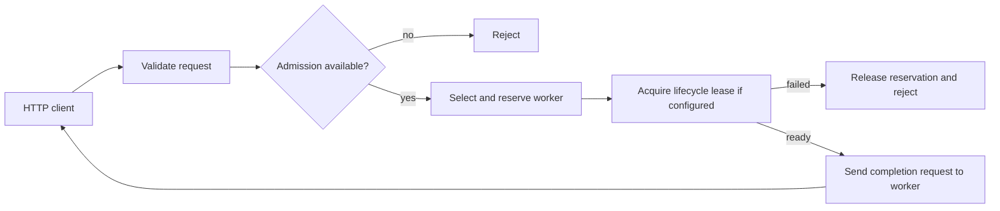

# Architecture

Liffo admits and routes requests to OpenAI-compatible workers. The worker owns
model execution and token batching.

## HTTP request path

The handler validates the request and checks model eligibility where a lifecycle
coordinator is configured. It takes an admission slot before reserving a worker.
Normal policy selection and reservation are atomic, so subsequent routing decisions
can see the reservation in the worker's in-flight count. The reservation is
accounting for load, and the gateway admission cap bounds total active work.
The admission queue has its own waiter limit. Deployments must bound connections
and HTTP handlers at the edge.

After reserving the selected worker, HTTP takes any required readiness lease.
A failed lease acquisition rolls back the reservation. Successful requests hold
the lease through the upstream operation. The gateway releases its accounting
on completion, error, or cancellation.

The HTTP handler makes one upstream completion attempt. It streams SSE and
propagates cancellation. A truncated upstream stream can mark a worker unhealthy,
allowing a later request to use a healthy peer. `Gateway.Handle` is a separate
in-process entry point. It uses the same admission mechanism, acquires its lease
before the executor reserves a worker, and can retry eligible failures before
the first visible content. The `retry_enabled` setting applies to that executor.

## Model lifecycle

The managed CLI starts one local `llama-server` from an allowlisted logical model
ID. The resolved path must stay under `model_root`. Loading waits for worker
health before marking the model ready. Draining stops new leases and waits for
existing work before eviction. See the [managed-worker setup](REAL_INFERENCE.md#managed-worker).

## Routing

| Policy | Selection signal |
| --- | --- |
| Round robin | Rotate through available workers |
| Least in-flight | Current in-flight count, with rotation for idle ties |
| Prefix affinity | Worker affinity for shared prefixes |
| Hybrid | Load, affinity, and health |
| Capacity-normalized least in-flight | In-flight count divided by configured capacity |
| Shortest estimated workload | In-flight count times estimated service time, divided by capacity |
| Multi-SLO | Configured cost and quality plus observed or estimated latency and load |

The workload estimate uses a worker latency prior or TTFT moving average.
The two capacity-normalized policies break equal scores by worker ID.
Affinity is a routing hint. The worker determines whether a cached prefix can be reused.

The gateway lives in `internal/adapt`, routing in `internal/route`, lifecycle in
`internal/modellife`, and telemetry in `internal/obs`. The benchmark client and
reports live in `internal/client`, `internal/metrics`, and `internal/report`.
See the [deployment boundary](../SECURITY.md) and [validation commands](VALIDATION.md).
