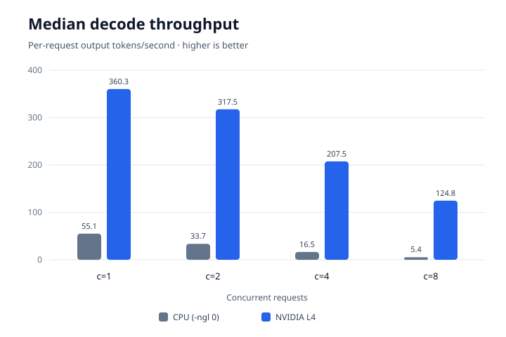
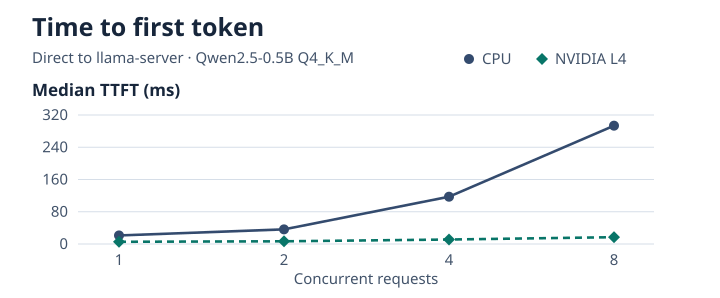

# Reference benchmark

> One model, one allocation, two execution paths, and 256 successful streamed
> requests. These measurements demonstrate the benchmark workflow—not a
> universal hardware claim.

[Documentation](README.md) · [Aggregate report](../reports/reference-cpu-gpu-2026-11-06.md) · [Reproduce it](REAL_INFERENCE.md)

---

## Result snapshot

| Median per-request decode throughput ↑ | Median time to first token ↓ |
|---|---|
|  |  |

| | CPU | NVIDIA L4 GPU |
|---|---:|---:|
| Successful requests | 128 / 128 | 128 / 128 |
| Median TTFT | 48.8 ms | 9.0 ms |
| Median decode rate | 29.7 tok/s | 264.0 tok/s |
| Peak sampled memory | 694 MiB RAM | 734 MiB VRAM |
| Peak sampled GPU utilization | — | 88% |

The GPU path delivered lower TTFT and higher per-request decode throughput in
every tested concurrency cell. CPU aggregate output peaked around concurrency
2–4; the L4 continued increasing aggregate output through concurrency 8.

## Controlled environment

| Component | Configuration |
|---|---|
| Host | Linux x86_64; AMD EPYC 7R13; 8 logical CPUs; 30 GiB RAM |
| Accelerator | NVIDIA L4, 23,034 MiB; driver 580.178.04 |
| Runtime | llama.cpp b12177 (`6c01da627`); CUDA 12.8 for GPU |
| Model | Qwen2.5-0.5B-Instruct Q4_K_M |
| Context | 2,048 tokens |
| CPU path | 8 threads, 8 server slots, `-ngl 0` |
| GPU path | 8 server slots, full 25/25-layer offload |
| Matrix | Concurrency 1, 2, 4, 8; 32 requests per cell |

CPU and GPU matrices ran sequentially on the same allocation with identical
prompts and token limits. All 256 requests succeeded with zero SSE parse
errors.

### Proof that the model reached the GPU

```text
offloaded 25/25 layers to GPU
CUDA0 model buffer size = 373.73 MiB
CUDA0 KV buffer size = 96.00 MiB
```

GPU-utilization samples alone are not treated as proof of model offload.

## Complete matrix

| Mode | Concurrency | TTFT p50 ↓ | Latency p50 ↓ | Decode p50 ↑ | Wall output rate ↑ |
|---|---:|---:|---:|---:|---:|
| CPU | 1 | 21.2 ms | 1,031.8 ms | 55.1 tok/s | 49.4 tok/s |
| CPU | 2 | 36.3 ms | 1,652.7 ms | 33.7 tok/s | 58.9 tok/s |
| CPU | 4 | 117.3 ms | 3,505.9 ms | 16.5 tok/s | 59.7 tok/s |
| CPU | 8 | 293.5 ms | 9,130.8 ms | 5.4 tok/s | 40.4 tok/s |
| GPU | 1 | 5.5 ms | 179.6 ms | 360.3 tok/s | 220.5 tok/s |
| GPU | 2 | 6.7 ms | 201.5 ms | 317.5 tok/s | 396.2 tok/s |
| GPU | 4 | 11.1 ms | 299.3 ms | 207.5 tok/s | 565.2 tok/s |
| GPU | 8 | 16.9 ms | 455.5 ms | 124.8 tok/s | 673.3 tok/s |

## How to read the metrics

- **TTFT** is time to the first non-empty streamed content delta. Lower is
  better for interactive responsiveness.
- **Latency** is full request wall time. It includes queueing, prefill, decode,
  and streaming overhead.
- **Per-request decode rate** divides output tokens by the request's decode
  window after TTFT. It describes an individual request.
- **Wall output rate** divides all successful output tokens by matrix elapsed
  time. It describes aggregate service throughput.

Per-request decode rate and wall output rate answer different questions and
must not be substituted for one another.

## Reproduce on another machine

```sh
./bin/liffo bench \
  --config configs/bench.yaml \
  --mode cpu \
  --concurrency 1 \
  --total-requests 32

./bin/liffo report \
  --raw results/raw \
  --target "actual CPU, RAM, GPU, OS, runtime, and model"
```

Repeat with a clean output directory for every mode and concurrency cell.
Record the actual CPU, RAM, GPU, driver, llama.cpp revision, model hash,
quantization, context, offload setting, concurrency, and token limit.

> **Comparison rule:** numbers from different hardware, model hashes,
> quantizations, context sizes, or runtime revisions are separate experiments—not
> matched before/after results.

The checked-in [Markdown report](../reports/reference-cpu-gpu-2026-11-06.md)
and [JSON aggregate](../reports/reference-cpu-gpu-2026-11-06.json) contain the
same public, privacy-safe measurements.
