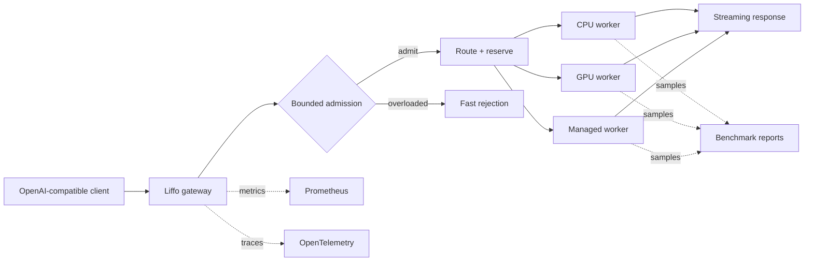

# Liffo documentation

> Build a reliable inference mesh, measure it honestly, and understand what
> happens when workers slow down, fail, or disappear.

[Project overview](../README.md) · [Run real inference](REAL_INFERENCE.md) · [See benchmark results](BENCHMARKS.md) · [Understand the architecture](ARCHITECTURE.md)

---

## Choose your path

| I want to… | Start here | You will leave with… |
|---|---|---|
| Evaluate the project | [Architecture](ARCHITECTURE.md) | The request path, reliability invariants, and deliberate boundaries |
| See measured evidence | [Benchmarks](BENCHMARKS.md) | CPU/GPU results, hardware manifest, metric definitions, and caveats |
| Run my own model | [Real inference](REAL_INFERENCE.md) | A repeatable CPU or GPU run with cleanup and proof of offload |
| Check release quality | [Validation](VALIDATION.md) | Build, race, integration, security, and portability evidence |
| Track planned work | [Roadmap](ROADMAP.md) | Current capabilities and milestones toward supported binary releases |

## System at a glance

Liffo sits above the inference runtime. It does not replace `llama-server` or
generate tokens itself; it makes a set of compatible workers safer to operate
and easier to measure.

## Documentation principles

- **Reproducible:** performance claims include the model, runtime, hardware,
  concurrency, and offload configuration.
- **Privacy-safe:** committed results contain aggregates, not prompts,
  completions, credentials, raw traces, or machine paths.
- **Explicit about boundaries:** admission is not continuous batching, and
  results from different hardware are not presented as matched comparisons.
- **Runnable:** commands use the checked-in CLI and example configuration.

For the shortest path from clone to a running gateway, return to the
[project README](../README.md#getting-started).
