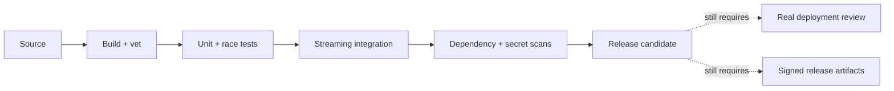

# Validation evidence

> Every release gate runs from this repository using checked-in configuration
> and self-contained test fixtures.

[Documentation](README.md) · [Roadmap](ROADMAP.md) · [Contributing](../CONTRIBUTING.md)

---

## Release-gate snapshot

| Quality gate | Status | Coverage |
|---|:---:|---|
| Build and unit tests | ✅ | All Go packages |
| Static analysis | ✅ | `go vet ./...` |
| Race detector | ✅ | All Go packages |
| Streaming integration | ✅ | Config → gateway → mock OpenAI SSE worker |
| Portability builds | ✅ | macOS arm64, Linux amd64, Windows amd64 |
| Vulnerability scan | ✅ | No known reachable vulnerabilities |
| License classification | ✅ | Direct dependency inventory reviewed |
| Secret and path scan | ✅ | No credentials, keys, private paths, raw traces, or models |

Validation was run on **2026-11-07** using macOS 27.0.1 (Darwin 27.0.0),
Apple M5 arm64, 16 GiB RAM, and Go 1.27.3.

## Commands behind the claims

```sh
go test ./...
go vet ./...
go test -race ./...
GOOS=linux GOARCH=amd64 go build ./cmd/liffo
GOOS=windows GOARCH=amd64 go build ./cmd/liffo
govulncheck ./...
go-licenses report ./...
gitleaks detect --source .
```

The self-contained streaming smoke test exercises a real HTTP path through the
CLI configuration and gateway to an in-process OpenAI-compatible worker. It
verifies streaming without requiring a model or GPU.

## Dependency remediation

The initial scan found reachable advisories in Go 1.27.1 and OpenTelemetry
1.44.0. The candidate moved to Go 1.27.3 and OpenTelemetry 1.45.0, then passed
the vulnerability scan with no findings.

## What these gates do—and do not—prove



The gates establish source-level correctness, concurrency coverage,
portability, and repository hygiene. They do not replace deployment-specific
TLS, authentication, network policy, model licensing, or capacity testing.

No inference binary or model is distributed here. The validated CPU/GPU
figures are retained as a [curated reference report](BENCHMARKS.md), while new
hardware claims require a fresh manifest and offload evidence.
