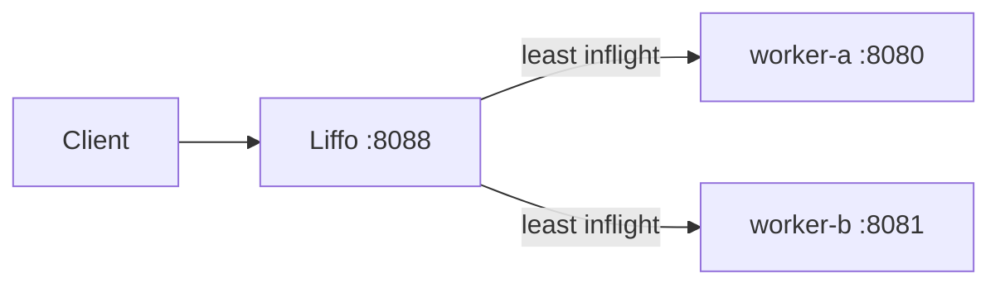
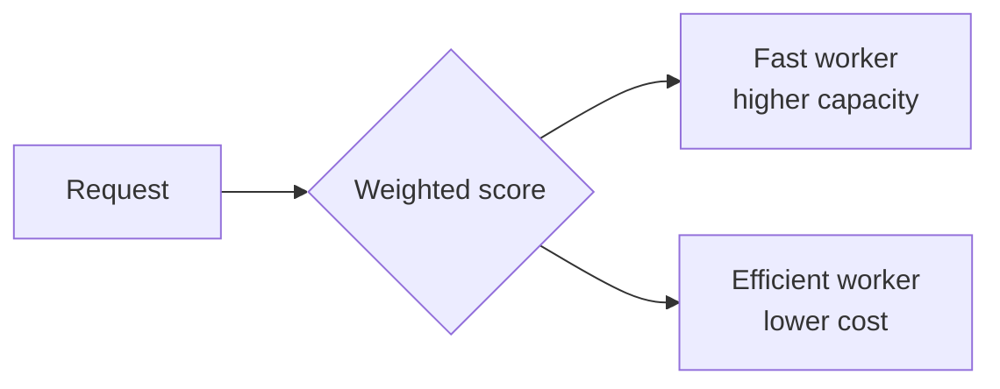

# Runnable configurations

> Two small topologies for exploring routing without embedding local model
> paths, credentials, or provider-specific settings.

[Project overview](../README.md) · [Architecture](../docs/ARCHITECTURE.md) · [Run real inference](../docs/REAL_INFERENCE.md)

---

## Example 1 — least-inflight across two workers



[`two-workers.yaml`](two-workers.yaml) gives both workers equal capacity and
routes each admitted request to the worker with fewer active requests.

```sh
./bin/liffo gateway --config examples/two-workers.yaml
./bin/liffo status --gateway http://127.0.0.1:8088
```

| Setting | Example value | Meaning |
|---|---:|---|
| `max_inflight` | 4 | Maximum active requests admitted by the gateway |
| `max_admit_waiters` | 64 | Bound on requests waiting to enter |
| `admit_timeout_ms` | 3000 | Maximum admission wait |
| worker `capacity` | 1 + 1 | Relative routing capacity |

## Example 2 — multi-SLO routing

[`multi-slo.yaml`](multi-slo.yaml) scores workers using cost, observed latency,
load, SLO fit, and quality metadata.



```sh
./bin/liffo gateway --config examples/multi-slo.yaml
```

| Signal | Weight | Purpose |
|---|---:|---|
| Cost | 0.20 | Prefer lower estimated request cost |
| Latency | 0.30 | Prefer lower latency estimate |
| Load | 0.20 | Avoid currently busy workers |
| SLO fit | 0.20 | Reward meeting the configured target |
| Quality | 0.10 | Respect the minimum quality tier |

The example metadata is illustrative, not measured performance. Replace it
with values produced by a reproducible calibration of your own workers.

## Measure either topology

```sh
./bin/liffo bench --config configs/bench.yaml --mode cpu --total-requests 10
./bin/liffo report --raw results/raw --target "actual hardware manifest"
```

Generated JSONL stays under `results/raw/` and is ignored by Git. Liffo stores
prompt identities and hashes, not prompt or completion bodies.
