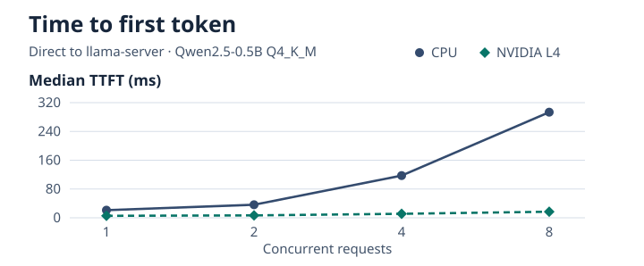
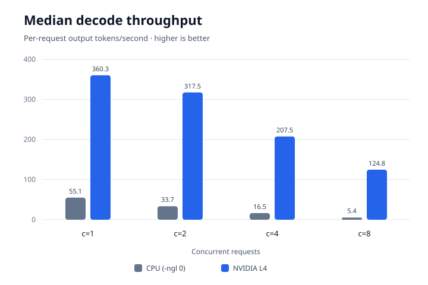

# CPU and NVIDIA L4 reference run

On November 6, 2026 UTC, the InferMesh benchmark client sent streaming requests
directly to CPU and CUDA `llama-server` on the same Camber allocation. Liffo
was outside the request path. Each backend completed 128 measured requests
with zero request or SSE parse errors.

Higher concurrency traded individual speed for total output on the L4.
From concurrency 4 to 8, wall output rose from 565.2 to 673.3 tokens/s
while median per-request decode fell from 207.5 to 124.8 tokens/s. CPU wall
output peaked at concurrency 4 and fell at 8.





These results cover one model, workload, and hardware allocation. They
do not measure gateway overhead, routing, or overload behavior.

## Environment and workload

| Component | Value |
|---|---|
| Host | Linux x86_64, AMD EPYC 7R13, 8 logical CPUs, 30 GiB RAM |
| GPU | NVIDIA L4, 23,034 MiB, driver 580.178.04 |
| Runtime | llama.cpp b12177, `6c01da6278ab6c69ed67d9124806b50d2b299ba7`, CUDA 12.8 for GPU |
| Model | Qwen2.5-0.5B-Instruct Q4_K_M GGUF, file revision `6dd44a1fb35d11b5d1b28902876ce3cc9e882d0e` |
| Model SHA-256 | `74a4da8c9fdbcd15bd1f6d01d621410d31c6fc00986f5eb687824e7b93d7a9db` |
| CPU worker | Loopback port 18080, 8 threads, 8 slots, 8,192 total context tokens, `-ngl 0` |
| GPU worker | Loopback port 18081, 8 threads, 8 slots, 8,192 total context tokens, `-ngl 999` |
| Workload | 32 measured requests per cell. The same three synthetic prompts in each cell. |
| Warmup | 3, 2, 4 and 8 requests at concurrency 1, 2, 4 and 8, respectively |

The worker runs were sequential. The retained prompt hashes match the
[reference config](../configs/bench-reference.yaml). See the
[method and reproduction limits](../docs/BENCHMARKS.md).

## Overall

| Mode | N | Errors | TTFT p50 | Latency p50 | Decode p50 | RAM max | VRAM max | GPU util max |
|---|---:|---:|---:|---:|---:|---:|---:|---:|
| CPU | 128 | 0 | 48.8 ms | 1,619.0 ms | 29.7 tok/s | 694 MiB | 0 MiB | 0% |
| GPU | 128 | 0 | 9.0 ms | 180.7 ms | 264.0 tok/s | 526 MiB | 734 MiB | 88% |

## By concurrency

| Mode | Concurrency | TTFT p50 | Latency p50 | Per-request decode p50 | Wall output rate |
|---|---:|---:|---:|---:|---:|
| CPU | 1 | 21.2 ms | 1,031.8 ms | 55.1 tok/s | 49.4 tok/s |
| CPU | 2 | 36.3 ms | 1,652.7 ms | 33.7 tok/s | 58.9 tok/s |
| CPU | 4 | 117.3 ms | 3,505.9 ms | 16.5 tok/s | 59.7 tok/s |
| CPU | 8 | 293.5 ms | 9,130.8 ms | 5.4 tok/s | 40.4 tok/s |
| GPU | 1 | 5.5 ms | 179.6 ms | 360.3 tok/s | 220.5 tok/s |
| GPU | 2 | 6.7 ms | 201.5 ms | 317.5 tok/s | 396.2 tok/s |
| GPU | 4 | 11.1 ms | 299.3 ms | 207.5 tok/s | 565.2 tok/s |
| GPU | 8 | 16.9 ms | 455.5 ms | 124.8 tok/s | 673.3 tok/s |

## GPU placement

The inference-server log recorded:

```text
offloaded 25/25 layers to GPU
CUDA0 model buffer size = 373.73 MiB
CUDA0 KV buffer size = 96.00 MiB
```

See the [machine-readable aggregate](reference-cpu-gpu-2026-11-06.json) and
[metric definitions](../docs/BENCHMARKS.md#workload-and-metrics).
